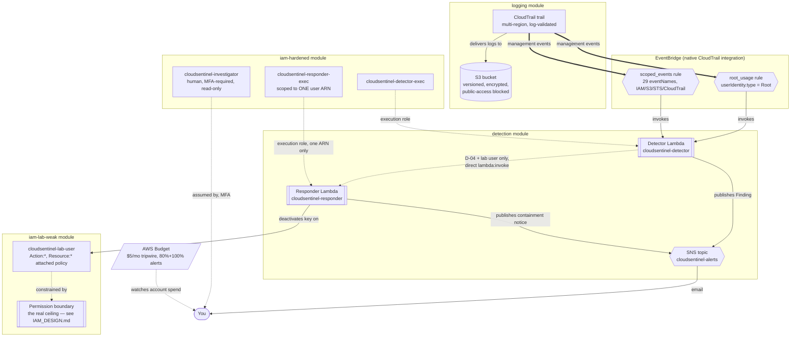

# Architecture

## System diagram

## Components and why they're separate Terraform modules

| Module | Owns | Why it's its own module |
|---|---|---|
| `logging` | CloudTrail trail, its S3 bucket and all bucket hardening (encryption, versioning, public-access-block, lifecycle, bucket policy) | The one thing every other module depends on for its own correctness (an ARN to reference, or — for the boundary and IAM policies — a resource to scope protection around). Nothing in this module depends on anything else. |
| `iam-hardened` | The three "well-behaved" roles: investigator, detector-exec, responder-exec | Grouped together because all three are the *trusted* side of this project's identity story — least-privilege, deliberately boring, defense-in-depth-appropriate roles — as opposed to... |
| `iam-lab-weak` | The lab user, its over-permissive attached policy, and its permission boundary | ...the one identity in this project that's deliberately the opposite: broad attached policy, real safety coming entirely from the boundary. Kept in its own module so its very different design intent (see `IAM_DESIGN.md`) is never accidentally blended with the hardened roles' reasoning. |
| `detection` | Both Lambda functions, both EventBridge rules, the SNS topic | The actual detect → alert → respond pipeline — the part of this project that does something at runtime, as opposed to the IAM/logging modules, which only establish the environment the pipeline runs inside. |

`environments/lab` is the one root module that wires all four together for a single deployable
environment, plus the account-wide cost tripwire (`aws_budgets_budget.cost_tripwire`) — see
`COST.md` for why that resource lives at the environment level rather than inside `detection`.

## Why the detector and responder are two separate Lambdas with two separate execution roles

It would have been simpler to fold "evaluate the event" and "deactivate the key" into one function. They
were deliberately kept apart for blast-radius separation: the detector's execution role never gets
`iam:UpdateAccessKey` on anything, and the responder's execution role never gets broad event-evaluation
permissions or `sns:Publish` beyond its own containment notice — each role is exactly as powerful as its
one job requires (see `policies/lambda-detector-exec.json.tpl` vs `policies/lambda-responder-exec.json.tpl`).
If the detector Lambda were ever compromised or had a bug that let an attacker control its behavior, the
attacker still could not directly call `iam:UpdateAccessKey` themselves — they could, at most, invoke the
responder (scoped to exactly one function ARN — see `IAM_DESIGN.md` §4), and the responder's own three
layers of defense-in-depth would still apply. Splitting detect and respond into separately-scoped
functions is what makes that defense-in-depth structure possible; a single merged Lambda with a role that
could do both would collapse two independent layers into one.

## Data flow, end to end

1. **CloudTrail** logs a management-event API call (or console sign-in) to the S3 bucket the `logging`
   module owns, and — independently, via EventBridge's native CloudTrail integration (no CloudWatch Logs
   subscription, no per-GB cost; see `COST.md`) — the same event becomes available to EventBridge rules
   in near-real-time.
2. **EventBridge** evaluates the event against two rules (see `terraform/modules/detection/main.tf`'s
   header comment and `DETECTIONS.md` for why it's two rules, not five or one):
   - `root_usage` — matches `userIdentity.type == "Root"`, any service, any action.
   - `scoped_events` — matches a merged list of 29 specific `eventName`s across
     `aws.iam`/`aws.s3`/`aws.sts`/`aws.cloudtrail`, covering D-02 through D-05.
   Either match invokes the **detector Lambda**.
3. The **detector** (`lambda/detectors/dispatcher/handler.py`) runs the event through all five rule
   functions in `rules/ALL_RULES`. Each independently returns a `Finding` or `None`; a single event can
   produce more than one `Finding` (e.g. `DeleteBucket` performed by root matches both D-01 and D-02 —
   see `tests/unit/dispatcher/test_detection_rules.py::TestDispatcherRouting`).
4. For each `Finding`, the detector publishes to the **SNS topic** (email alert to the operator) and, if
   the finding is D-04 *and* its affected user is exactly the configured lab user, invokes the
   **responder Lambda** directly (`lambda:invoke`, `InvocationType="Event"` — async, the detector doesn't
   block waiting on it).
5. The **responder** (`lambda/responders/quarantine/handler.py`) independently re-verifies the target
   identity, re-queries live IAM state, deactivates the relevant access key(s), and publishes its own
   containment notice to the same SNS topic.

## Design decisions worth knowing before you change something

- **Deterministic ARN construction.** Several modules build an ARN as a plain string
  (`"arn:aws:service:${region}:${account_id}:resource/${name}"`) from name *variables*, rather than
  referencing another module's resource *output* — the `trail_arn` local in `logging`, the
  `sns_topic_arn`/`lab_user_arn`/`responder_function_arn` locals in `iam-hardened`. This exists because
  the real resource often doesn't exist yet when the policy that needs to reference it is created (e.g.
  the CloudTrail bucket policy has to grant CloudTrail write access *before* the trail can be created
  successfully; the detector's execution-role policy has to grant `lambda:InvokeFunction` on the
  responder before the responder Lambda exists). Terraform has no "give me the ARN this resource *will*
  have" mechanism across independent resources, so the calling root module (`environments/lab/main.tf`)
  defines every shared name exactly once, in `locals`, and threads the same variable into every module
  that needs it — see that file's own header comment.
- **Two EventBridge rules, not five.** EventBridge ANDs together every top-level key in one pattern —
  there's no way to express "eventName is X OR userIdentity.type is Root" in a single rule. Root usage
  must match on `userIdentity.type` (root can call anything), so it needs its own rule; the other four
  detections all match on `eventName` within the same few services, so they're folded into one merged
  rule to keep the infrastructure small. The real per-detection logic lives in Python
  (`rules/*.py`), not in more EventBridge rules — see `DETECTIONS.md`.
- **Direct Lambda invocation, not a third EventBridge rule, for detector → responder.** It's one
  tightly-coupled detect-then-respond pair, already IAM-scoped to exactly one function ARN, and simpler
  to unit test directly than inventing a custom EventBridge event schema would be.
- **No Terraform-managed access key on the lab user.** If Terraform owned the lab user's access key, the
  responder's own deactivation would put live AWS state at odds with Terraform state, and the next
  `terraform apply` would "fix" (reactivate) the very key just quarantined. Key lifecycle for simulated
  incidents is entirely out-of-Terraform, via `scripts/simulate_events.sh` and the AWS CLI — see
  `terraform/modules/iam-lab-weak/main.tf`'s header comment.
