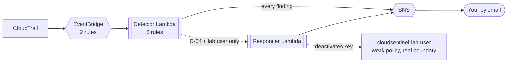

# CloudSentinel

A single-account AWS detection-and-response lab: CloudTrail feeds EventBridge, EventBridge feeds a
Lambda that evaluates five detection rules against an intentionally over-permissioned "lab" IAM
identity, and — for the one detection where automated action is actually appropriate — a second Lambda
contains the incident by deactivating the exposed credential. Every other finding is alert-only.

**Build status:** infrastructure, application code, and the full offline test/verification suite are
complete and passing (see below). This has **not yet been deployed to real AWS** from this build
environment — no `terraform` binary or AWS credentials were available here. `RESULTS.md` is the live
tracker for what's been verified against an actual deployment; until it's filled in, treat any claim
about real AWS behavior as **requires verification**, not confirmed.

```
Unit tests:          36 passed, 0 failed
Offline tests:       13 passed, 0 failed
Checkov:             59 passed, 0 failed, 23 skipped (all documented — see SECURITY.md)
Structural validator: PASS
Live AWS tests:      REQUIRES VERIFICATION — see RESULTS.md
```

## Architecture



Full diagram, module breakdown, and the reasoning behind each design decision: `ARCHITECTURE.md`.

## The five detections

| ID | Detects | Automated response |
|---|---|---|
| D-01 | Root account usage | No |
| D-02 | Audit-logging tamper | No |
| D-03 | Privilege-escalation primitives | No |
| D-04 | Access key created/activated | **Yes — deactivates the key** |
| D-05 | S3 bucket exposure | No |

Full detail: `DETECTIONS.md`. Why only one has an automated response, and how that response is scoped
three independent ways so it can never touch anything but the one identity it's meant to protect:
`IAM_DESIGN.md`.

## Quickstart

```bash
# 1. Configure
cd terraform/environments/lab
cp terraform.tfvars.example terraform.tfvars
# edit terraform.tfvars — see that file's comments, especially for operator_principal_arn

# 2. Deploy (two-phase: budget tripwire first, then everything else)
cd ../../..
./scripts/deploy.sh

# 3. Confirm the SNS and Budget subscription emails AWS just sent you — click both

# 4. Verify
./scripts/security_scan.sh          # Checkov against the deployed source
./scripts/simulate_events.sh all    # trigger D-02 through D-05 for real; check your inbox
pytest tests/live                   # automated live verification, incl. the boundary simulation

# 5. When done evaluating
./scripts/teardown.sh
```

Full prerequisites, exact commands, and what to expect at each step:
`TESTING.md`. Filled-in results from an actual run go in `RESULTS.md`, not here.

## Documentation

| Doc | Covers |
|---|---|
| `ARCHITECTURE.md` | System design, module boundaries, data flow, why things are built the way they are |
| `THREAT_MODEL.md` | Scope, assets, actors, an attack-scenario walkthrough, explicit non-goals |
| `IAM_DESIGN.md` | The permission boundary's full design story — including a design mistake caught and fixed before deployment — and its live empirical verification |
| `DETECTIONS.md` | Index of all five detections and the EventBridge-rule architecture behind them |
| `INCIDENT_RESPONSE.md` | Triage runbook + a fill-in-after-you-run-it D-04 case study |
| `TESTING.md` | Full test-suite map, exact commands, and an honest account of what has/hasn't been run |
| `RESULTS.md` | Template for real, filled-in-after-deployment verification evidence |
| `SECURITY.md` | Checkov findings (every skip documented and reasoned), known limitations, secrets handling |
| `COST.md` | Cost architecture, estimated monthly cost, budget tripwire mechanics |

## Safety and scope

Everything here targets one AWS account you deploy it into — nothing external is ever scanned, called,
or touched. The only automated response this project performs (deactivating an access key) is
reversible, not destructive, and is scoped by IAM policy, application code, and a live re-check to
exactly one intentionally-created lab identity — never anything else in the account. See
`THREAT_MODEL.md` and `SECURITY.md` for the full constraints this was built under.

## A note on how this was built

This project was built with AI assistance (Claude) as a coding collaborator — architecture decisions,
including the permission-boundary redesign documented in `IAM_DESIGN.md`, were made and verified through
that collaboration rather than written solo. Every claim in this documentation about test results or
Checkov output reflects a command actually run against this code, not a projected or invented result —
see `TESTING.md` for exactly what was and wasn't runnable in the environment this was built in, and
`RESULTS.md` for what's still pending verification against a real AWS deployment.

## License

MIT — see `LICENSE`.
